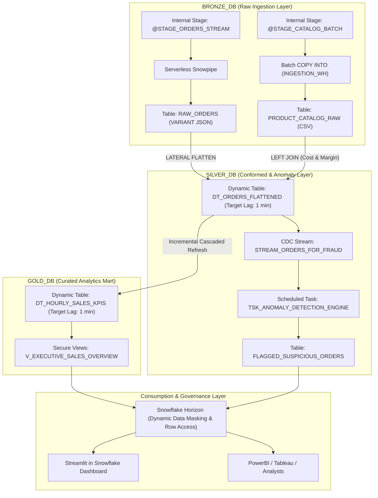
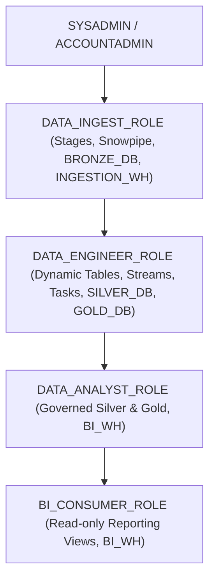

# Snowflake Modern Data Platform
### OmniRetail 360 Architecture & Deployment Blueprint
**Author / Technical Lead:** Kundan Kumar (Data & AI Competency)

---

## 1. The Business Use Case: "OmniRetail 360"

### Business Context
OmniRetail 360 is a global omnichannel e-commerce retail enterprise that handles four core data workflows:
1. **Real-Time Customer Checkouts (JSON Stream):** Ingesting transactions 24/7 containing customer profile information, nested item arrays, and payment details.
2. **Periodic Supplier Catalog (CSV Batch):** Ingesting periodic product master data dumps (supplier costs, retail prices, categories) from an ERP system.
3. **Executive KPI Mart:** Aggregating hourly revenue, gross profit margin, units sold, and regional performance.
4. **Real-Time Fraud & Anomaly Audit:** Automatically evaluating order risk thresholds and logging suspicious transactions.

---

## 2. Architectural Boundaries: Where Each Technology Fits

| Technology | Operational Role in OmniRetail 360 | Architectural Rationale | Target Object |
|---|---|---|---|
| **Batch COPY INTO** | Bulk Periodic Master Catalog Load | **User-managed Virtual Warehouse (`INGESTION_WH`)**: Ideal for scheduled, predictable bulk file syncs (e.g. periodic CSV catalog dumps) where compute warehouse runtime is controlled and suspended immediately after execution. | `BRONZE_DB.RAW.PRODUCT_CATALOG_RAW` |
| **Snowpipe** | Continuous Micro-Batch Ingestion | **Serverless Compute Pool**: Ideal for unpredictable, event-driven order arrivals 24/7. Serverless compute scales automatically without paying for an idle virtual warehouse. | `BRONZE_DB.RAW.RAW_ORDERS` |
| **Dynamic Tables** | Declarative Medallion ELT (`BRONZE` -> `SILVER` -> `GOLD`) | **Declarative SQL & Dependency DAG**: Ideal for multi-hop transformations, unnesting JSON (`LATERAL FLATTEN`), joining catalog data, and calculating hourly profit margins with a target freshness SLA (1 min). Snowflake handles incremental CDC under the hood. | `SILVER_DB.CONFORMED.DT_ORDERS_FLATTENED` & `GOLD_DB.ANALYTICS.DT_HOURLY_SALES_KPIS` |
| **Streams & Tasks** | Imperative CDC & Real-Time Fraud Engine | **Procedural Logic & Conditional Upsert**: Dynamic Tables cannot execute procedural `IF/ELSE`, conditional `MERGE` statements, or trigger fraud investigation alerts. A CDC Stream on Silver feeds a scheduled Task that evaluates risk scores and populates the fraud audit table. | `SILVER_DB.FRAUD.FLAGGED_SUSPICIOUS_ORDERS` |
| **Snowflake Horizon** | Dynamic Data Masking & Row Access Policies | **In-Place Governance**: Enforces masking on customer emails (`sa****@...`) and cards (`XXXX`) and restricts regional row access dynamically based on caller role without creating redundant tables. | Applied to `SILVER_DB` & `GOLD_DB` |
| **Zero-Copy Cloning & UNDROP** | Operational Agility | **Metadata-Only Operations**: Instantly clones production databases for DEV/QA in seconds at $0 extra storage cost and rescues dropped tables with zero downtime. | `SILVER_DB_DEV` & `UNDROP TABLE` |
| **Streamlit in Snowflake** | Downstream Serving & UI | **Native Application Hosting**: Renders interactive pipeline health KPIs, profit charts, and an interactive role switcher natively in Snowsight. | Native Streamlit App |

---

## 3. Multi-Database & RBAC Architecture

The architecture uses **dedicated databases** for each Medallion tier rather than schemas:



### Enterprise RBAC Roles Hierarchy:


---

## 4. How to Deploy via GitHub Actions (Step-by-Step)

The repository includes a ready-to-use GitHub Actions workflow configured at:
`.github/workflows/snowflake_deploy.yml`

Follow these exact steps to deploy through GitHub Actions:

### Step 1: Push Project to GitHub
Initialize your Git repository and push your project to GitHub:
```bash
git init
git add .
git commit -m "feat: initial commit of Snowflake modern data pipeline"
git branch -M main
git remote add origin https://github.com/<YOUR_GITHUB_USERNAME>/<YOUR_REPOSITORY_NAME>.git
git push -u origin main
```

### Step 2: Configure GitHub Repository Secrets
To allow GitHub Actions to authenticate securely to Snowflake without hardcoding passwords:
1. Open your GitHub Repository in your browser.
2. Navigate to **Settings** -> **Secrets and variables** -> **Actions**.
3. Under **Repository secrets**, click **New repository secret** and add the following 3 secrets:
   - `SNOWFLAKE_ACCOUNT`: Your Snowflake account locator (e.g. `xy12345.us-east-1` or `org-account_name`).
   - `SNOWFLAKE_USER`: Your Snowflake username (e.g. `KUNDAN_ADMIN`).
   - `SNOWFLAKE_PASSWORD`: Your Snowflake password.

### Step 3: Trigger the Deployment
You have two ways to run the deployment:
- **Automatic on Git Push:** Any push or merged Pull Request modifying files under `snowflake/migrations/**` automatically triggers the workflow.
- **Manual Trigger (Workflow Dispatch):**
  1. In your GitHub repository, click the **Actions** tab.
  2. Select **Snowflake Schemachange Deployment** from the left sidebar.
  3. Click **Run workflow** -> Select branch `main` -> Click **Run workflow**.

### Step 4: Verify Deployment in Snowflake
Once the GitHub Action completes (green checkmark):
1. Open Snowflake Snowsight.
2. Run:
   ```sql
   USE ROLE ACCOUNTADMIN;
   SHOW DATABASES LIKE '%_DB';
   SELECT * FROM UTILS_DB.CHANGELOG.CHANGE_HISTORY ORDER BY INSTALLED_ON DESC;
   ```
3. All migration scripts (`V1.1.1` through `R__01`) will be recorded in the change history table.

---

## 5. Alternative: Instant Deployment via Snowsight SQL Worksheet

If deploying directly in the browser without GitHub:
1. Log in to Snowflake Snowsight as `ACCOUNTADMIN`.
2. Open a new SQL Worksheet.
3. Open and run the migration scripts in `snowflake/migrations/` in sequential order:
   - `V1.1.1__setup_foundations.sql`: Creates Warehouses, Databases (`BRONZE_DB`, `SILVER_DB`, `GOLD_DB`, `UTILS_DB`), and RBAC roles.
   - `V1.1.2__bronze_ingestion_snowpipe_and_copy.sql`: Creates stages, raw tables, and the serverless Snowpipe.
   - `V1.1.3__silver_gold_dynamic_tables.sql`: Creates Silver and Gold Dynamic Tables with `LATERAL FLATTEN` and catalog join.
   - `V1.1.4__stream_and_task_fraud_detection.sql`: Creates CDC Stream on Silver and the Task for fraud detection.
   - `V1.1.5__horizon_security_governance.sql`: Applies Dynamic Data Masking and Row Access Policies.
   - `V1.1.6__automated_pipeline_orchestration.sql`: Creates automated streaming generator task, pipeline START/STOP procedures, and status monitoring view.
   - `R__01_serving_views.sql`: Creates secure serving views for downstream BI.

---

## 6. How to Run the 5-Minute Automated Live Demo

The demo is **100% automated**—no manual file creation or manual data inserts required!

Open Snowsight, create a new SQL Worksheet, and paste:  
`snowflake/demo_interactive_runsheet.sql`

Run through the 5 quick verification steps (takes 5-7 minutes):
1. **Start Autonomous Pipeline:** `CALL UTILS_DB.PUBLIC.SP_START_PIPELINE();` (Tasks feed data and process fraud automatically every 60s).
2. **Pipeline Heartbeat View:** Run `SELECT * FROM UTILS_DB.PUBLIC.V_LIVE_PIPELINE_STATUS;` to see data continuously moving through Bronze, Silver, Fraud, and Gold.
3. **Conformed Silver Dynamic Table:** Verify flattened order line items with gross profit margins calculated from the catalog join.
4. **Automated Fraud Alerts:** View `SILVER_DB.FRAUD.FLAGGED_SUSPICIOUS_ORDERS` populated automatically by the Streams & Tasks engine.
5. **Snowflake Horizon Dynamic Masking:** Contrast the `ACCOUNTADMIN` plaintext view with the `DATA_ANALYST_ROLE` masked email/card and filtered regional view.
6. **Operational Agility:** Execute a zero-copy clone (`CREATE DATABASE SILVER_DB_DEV CLONE SILVER_DB;`).
7. **Stop Pipeline (Post-Demo):** `CALL UTILS_DB.PUBLIC.SP_STOP_PIPELINE();` to pause background tasks.

---

## 7. Launching Streamlit in Snowflake

1. In Snowsight, navigate to **Projects -> Streamlit**.
2. Click **+ Streamlit App**:
   - **App Name:** `OmniRetail 360 Dashboard`
   - **Database:** `GOLD_DB`
   - **Schema:** `REPORTING`
   - **Warehouse:** `BI_WH`
3. Paste the contents of `streamlit/streamlit_analytics_app.py`.
4. Click **Run** to launch the interactive dashboard with real-time KPI cards, profit charts, and the role switcher.
